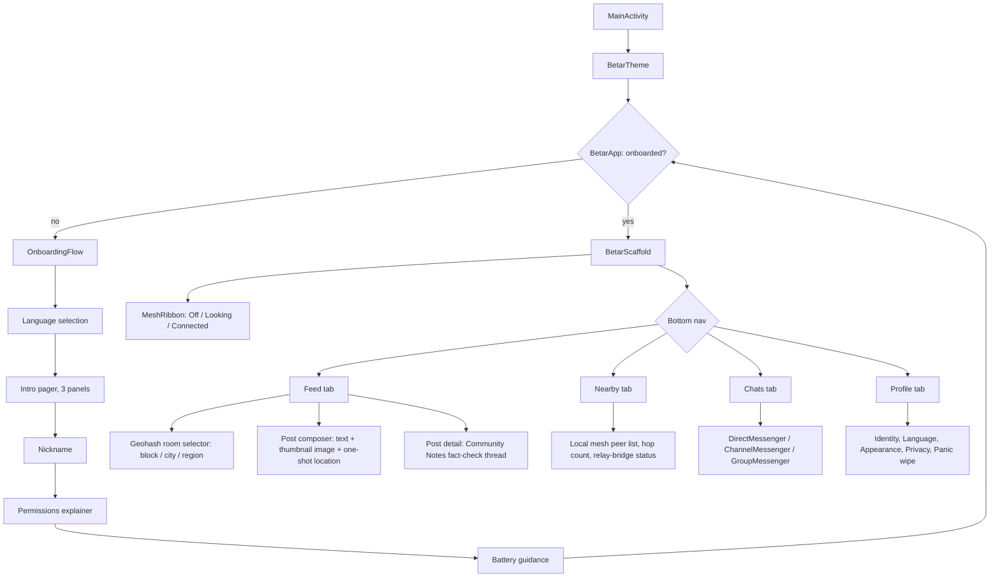

# Architecture

Detailed system architecture for Project Mesh and Betar. Companion to `WHITEPAPER.md` section 5.

---

## 1. Principles

1. **One brain, many faces.** All security- and protocol-critical logic lives once, in a shared
   Rust core. Front-ends are thin.
2. **Native at the edges.** UI and radio drivers are native per platform (Kotlin/Compose,
   Swift/SwiftUI), because that is where OS-specific behaviour and reliability live.
3. **The native layer is a dumb byte pipe.** It carries opaque buffers. It makes no crypto or
   routing decisions.
4. **Untrusted input is parsed in Rust.** All wire parsing happens in the memory-safe core.
5. **No proprietary cloud in the core.** The core has zero dependency on Google or Apple
   services.
6. **No tier is required for the system to work, only for it to reach further.** A device with
   no internet, ever, still posts, chats, and reads its local mesh cluster. A relay bridge
   extends reach. It is not a dependency the mesh needs to function.

## 2. Why three tiers, not one

I designed Project Mesh around one constraint that every pure-mesh messenger eventually hits:
Bluetooth LE and Wi-Fi Direct only reach a device that is physically nearby, tens to a few
hundred metres per hop. A platform that only works at that range is not a replacement for a
global social network. A platform that requires the internet is not resistant to anyone who
controls the internet. Project Mesh solves this with three tiers instead of one.

**Tier 1, local mesh, solves the range problem without any infrastructure.** Store-carry-forward
gossip means device A never has to meet device C directly. A meets B. B physically carries A's
post or message until B meets C, then relays it. Reach grows with how many people are running
the app nearby and how much time passes, not with raw radio range. A dense area, such as a
city or a protest, reaches city-wide in minutes to hours. A sparse area stays local until
someone bridges it.

**Tier 2, the Nostr relay bridge, solves the reach problem without creating a new single point
of control.** The moment any one device in a local mesh cluster has internet access, even
briefly, it publishes everything that cluster has seen to the public Nostr relay network, and
pulls down everything relevant from that network back into the cluster. No individual user
needs their own internet connection. They only need to be near someone, at some point, who has
one. Nostr already runs at the scale this needs: over 850 independent relays across more than
40 countries, as of the research done for this project in October 2026. Killing one relay does
not kill the network, the same property Betar wants, already proven at scale by someone else's
infrastructure.

**Tier 3, global reach, is what tier 2 buys for free.** Once a post reaches any Nostr relay, it
is reachable from anywhere else that can reach a relay, which is most of the internet. This is
the same bridge Bitchat itself already uses, confirmed from its public documentation, and the
direct precedent for this design.

## 3. Layers

```
┌─────────────────────────────────────────────────────────────────┐
│ Presentation (native)                                            │
│  Android: Jetpack Compose        iOS: SwiftUI                     │
│  screens, navigation, accessibility, localization rendering      │
├─────────────────────────────────────────────────────────────────┤
│ Platform services (native)                                       │
│  foreground service / background modes, local notifications,     │
│  keystore/Secure Enclave access, permission handling,            │
│  radio drivers                                                    │
├─────────────────────────────────────────────────────────────────┤
│ FFI boundary (UniFFI-generated Kotlin & Swift bindings)          │
├─────────────────────────────────────────────────────────────────┤
│ Shared core (Rust)                                               │
│   ┌───────────────┐ ┌───────────────┐ ┌───────────────────────┐  │
│   │ crypto        │ │ mesh engine   │ │ app domain            │  │
│   │ identity      │ │ envelopes     │ │ chat / channels / grp │  │
│   │ Noise XX      │ │ store-carry-  │ │ feed (geohash rooms)  │  │
│   │ Double Ratchet│ │  forward      │ │ fact-check (Community │  │
│   │ sealing/AEAD  │ │ dedup + TTL   │ │  Notes model)         │  │
│   │ onion (Sphinx)│ │ scheduler     │ │ contacts / trust      │  │
│   └───────────────┘ └───────────────┘ └───────────────────────┘  │
│   ┌───────────────────────────────────────────────────────────┐  │
│   │ relay bridge: Nostr client, publishes/pulls signed events │  │
│   │   from the public relay network when any transport has    │  │
│   │   internet reachability                                    │  │
│   └───────────────────────────────────────────────────────────┘  │
│   ┌───────────────────────────────────────────────────────────┐  │
│   │ persistence: redb (encrypted at rest) + AEAD              │  │
│   └───────────────────────────────────────────────────────────┘  │
│   ┌───────────────────────────────────────────────────────────┐  │
│   │ radio abstraction trait: advertise/scan/connect/send/recv │  │
│   └───────────────────────────────────────────────────────────┘  │
└─────────────────────────────────────────────────────────────────┘
```

### 3.1 Android UI navigation

The presentation layer's screen graph, under
`android/app/src/main/java/app/betar/comm/ui/` in the `betar` repository:



This navigation graph describes the target structure for the pivot decided in this project's
2026-10-31 session. It has not been built yet. `docs/IMPLEMENTATION-STATUS.md` tracks what
exists today versus this target.

## 4. The radio abstraction

The core defines a transport-agnostic interface the native layer implements. Conceptually:

```rust
/// Implemented by each platform's native radio driver and passed into the core.
pub trait MeshTransport: Send + Sync {
    /// Begin advertising presence and scanning for peers.
    fn start(&self, service: ServiceId) -> Result<()>;
    fn stop(&self) -> Result<()>;
    /// Send an opaque frame to a connected peer.
    fn send(&self, peer: PeerHandle, frame: &[u8]) -> Result<()>;
    /// Native driver calls back into the core on these events.
    // on_peer_discovered(peer, rssi)
    // on_peer_connected(peer)
    // on_frame(peer, bytes)
    // on_peer_lost(peer)
}
```

Multiple transports, such as BLE, Wi-Fi Direct/Aware, MultipeerConnectivity, and a future LoRa
bridge, can be active at once. The core treats them as a pool of links. It does not care which
physical medium a frame arrived on. The Nostr relay bridge in section 2 is not a
`MeshTransport` implementation. It operates one level up, on fully-formed signed events, not raw
frames, because it talks to internet relays over WebSockets rather than to nearby radios.

## 5. Feed, images, and location: how the content model maps to the tiers

- **Feed posts are geohash-scoped.** Each post carries a geohash tag at a precision the author
  picks: city block, city, region, or country, the same pattern Bitchat uses for its own
  location channels. A user's feed is the geohash room for their current location plus any
  rooms they have joined manually. The feed is reverse-chronological. There is no ranking
  algorithm, because there is no server to run one on, and because an engagement-maximizing
  feed would work against the reason this protocol exists.
- **Images travel differently depending on the tier.** Over local mesh, only a small, lossy,
  EXIF-stripped thumbnail moves, chunked the same way the wire parser already chunks other
  data. A full-resolution image uploads only once a relay bridge exists, to a content-addressed
  blob store such as the Blossom protocol, mirrored across independent servers with no single
  required host. A device that never reaches a relay stays at thumbnail quality. This is a real
  limit, not a bug to hide.
- **Location sharing inside a chat is one-shot, never continuous.** A single location pin
  travels only through that specific thread's existing end-to-end encrypted channel. It is
  never broadcast to the mesh or the relay network. Continuous live-tracking location sharing
  is not implemented, and will not be until it has its own safety design: automatic expiry and
  geofencing, because it is the single highest-risk feature for a journalist or activist user if
  their device or the recipient's device is ever compromised.
- **Fact-checking follows the Community Notes model.** A note on a post is a signed event,
  gossiped the same way as the post itself. The bridging score that decides whether a note is
  shown as helpful is a public, deterministic algorithm. Any client or relay can compute it
  locally from the same synced events. No single scorer is authoritative. Local, client-side
  filtering of flagged illegal content uses this same web-of-trust data, so a user's own device
  can hide or warn on reported content without any server or relay being able to delete it
  globally.

## 6. Threading and lifecycle

- The core runs its scheduler on a dedicated worker, an async runtime in Rust such as Tokio or a
  hand-rolled executor, and communicates with the UI via events across the FFI boundary.
- On **Android**, a foreground service with an ongoing notification hosts the mesh engine so it
  survives while the app is backgrounded. OEM battery-manager whitelisting guidance is shown to
  the user.
- On **iOS**, the engine runs in the foreground and within the limited background execution
  Apple allows. The design assumes iOS relays chiefly in the foreground, called relay mode.

## 7. Persistence

- **`redb`, a pure-Rust embedded database, plus AEAD encryption**, stores envelopes, session
  state, contacts, and app data. This replaced an earlier design that specified SQLCipher,
  whose OpenSSL dependency would not build in this project's Windows development environment.
- The database key is stored in the platform keystore, Android Keystore or iOS Keychain plus
  Secure Enclave, and optionally wrapped by a user passphrase.
- The envelope store is size-bounded with priority-aware eviction. See `ROUTING-PROTOCOL.md`.

## 8. Build and bindings

- The core builds as a static or dynamic library per target: `aarch64` Android, `arm64` iOS,
  plus emulator/simulator targets and desktop for tests.
- **UniFFI** generates the Kotlin and Swift bindings from a single interface definition,
  keeping the FFI surface small and typed.
- Deterministic, reproducible builds are a first-class requirement. See `DISTRIBUTION.md`.

## 9. Testing strategy

- Pure-Rust unit and property tests cover crypto, parsing, dedup, and TTL logic.
- A simulation harness instantiates many virtual nodes with a synthetic mobility and contact
  model to measure delivery ratio and latency against density, a DTN evaluation.
- Fuzzing covers every wire parser that accepts untrusted input.
- Instrumented on-device tests cover radio drivers on representative low-end Android hardware.

---

**Developed by [Konko Maji](https://konkomaji.com/)**
